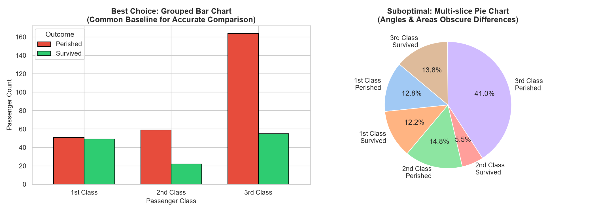
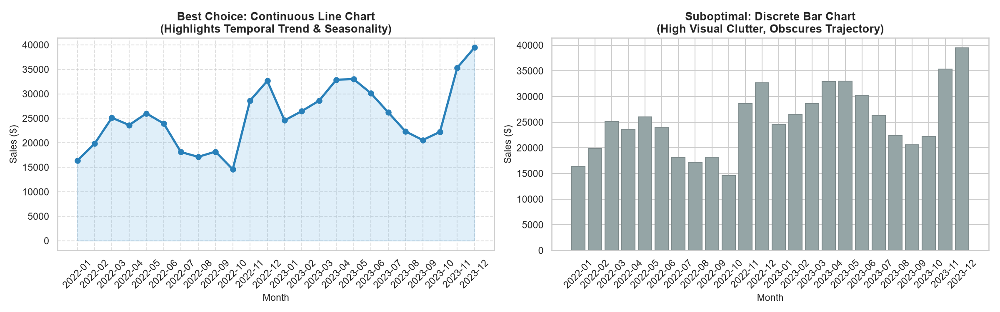
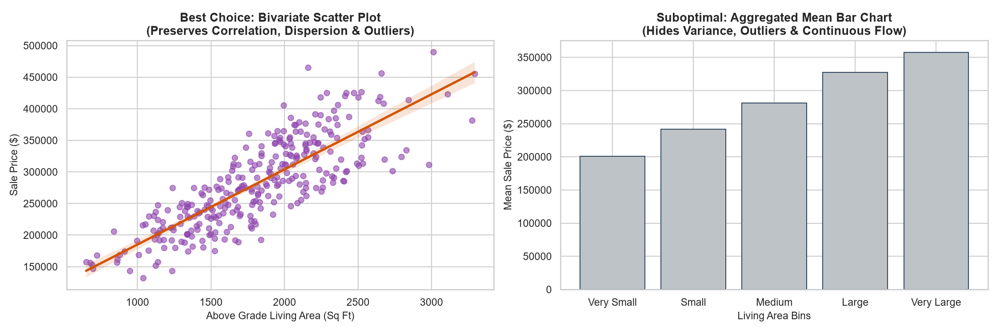

# DCS402 — Data Analytics & Visualization

This repository contains coursework, data cleaning notebooks, and visual analytics assignments analyzing how different chart types impact audience interpretation.

---

## Repository Structure

```
├── .gitignore
├── README.md
└── pandas/
    ├── cleaning.ipynb              # Data cleaning workflows and methods
    ├── pandas.ipynb                # Pandas exploration and manipulation
    └── assig/
        ├── assig.ipynb             # Assignment notebook with complete code & discussion
        ├── kaggle_titanic.csv      # Dataset 1: Categorical / survival data
        ├── kaggle_sales_trends.csv # Dataset 2: 24-Month continuous time-series
        ├── kaggle_house_prices.csv # Dataset 3: Continuous bivariate property data
        ├── chart1_titanic_comparison.png
        ├── chart2_sales_trend_comparison.png
        └── chart3_housing_comparison.png
```

---

## Assignment: Impact of Chart Types on Audience Interpretation

### Introduction
Data visualization translates complex quantitative data into intuitive visual patterns. Human perception decodes spatial position and length along a common baseline with far greater speed and precision than angles, areas, or disconnected categories. Selecting the right chart ensures audiences grasp key trends immediately without cognitive fatigue or distorted interpretations.

### Kaggle Datasets Used
1. **Titanic Survival Dataset:** [Kaggle Titanic Competition](https://www.kaggle.com/competitions/titanic) (Categorical proportions)
2. **Superstore Sales Dataset:** [Kaggle Sales Forecasting](https://www.kaggle.com/datasets/rohitsahoo/sales-forecasting) (Continuous time-series)
3. **Ames House Prices Dataset:** [Kaggle House Prices Competition](https://www.kaggle.com/competitions/house-prices-advanced-regression-techniques) (Continuous bivariate correlation)

---

### Chart 1: Titanic Survival by Passenger Class



* **Best Chart:** **Grouped Bar Chart** (versus a Pie Chart)
* **Explanation:** A grouped bar chart aligns survival counts along a shared horizontal baseline ($y = 0$). This allows viewers to instantly judge differences in bar heights and see that 3rd Class passengers suffered disproportionately high casualties. In contrast, a multi-slice pie chart encodes values into circular angles and 2D wedge areas, which human eyes frequently misjudge, obscuring relative class comparisons.

---

### Chart 2: Monthly Sales Trends Over Time



* **Best Chart:** **Continuous Line Chart with Markers** (versus a Discrete Bar Chart)
* **Explanation:** Time is continuous, and a line chart relies on connected slopes to intuitively display velocity, direction of change, and cyclical Q4 holiday spikes. Plotting 24 separate monthly vertical bars introduces heavy visual clutter ("chartjunk") and creates artificial barriers between months, obscuring the overarching long-term revenue momentum.

---

### Chart 3: Living Area vs. Sale Price



* **Best Chart:** **Bivariate Scatter Plot with Trendline** (versus an Aggregated Bar Chart)
* **Explanation:** A scatter plot maps each property as an individual coordinate pair, preserving critical pricing dispersion, density, and outliers (such as oversized homes sold at steep discounts). An aggregated bar chart averages data into broad bins, concealing price variance and misleading audiences into believing home values follow a rigid, uniform stair-step pattern.

---

### Conclusion & Justification
Matching visual encodings to the data's mathematical structure is essential for accurate audience interpretation: a **grouped bar chart** was selected for the Titanic dataset because linear lengths on a common axis are easier to compare than circular angles; a **line chart** was chosen for sales trends because continuous slopes intuitively convey rate of change without bar clutter; and a **scatter plot** was selected for housing prices because it preserves correlation density, variance, and outliers that summary bar averages hide.
